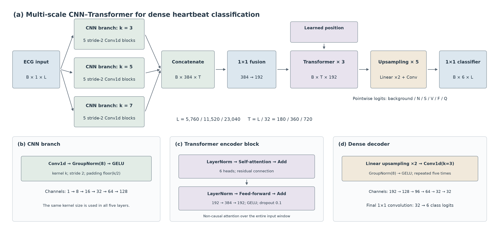
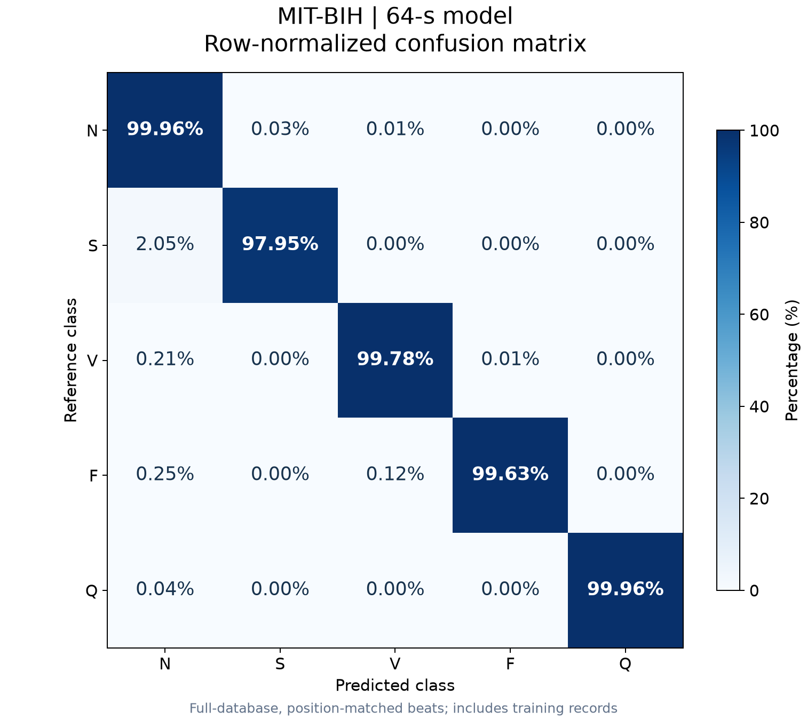
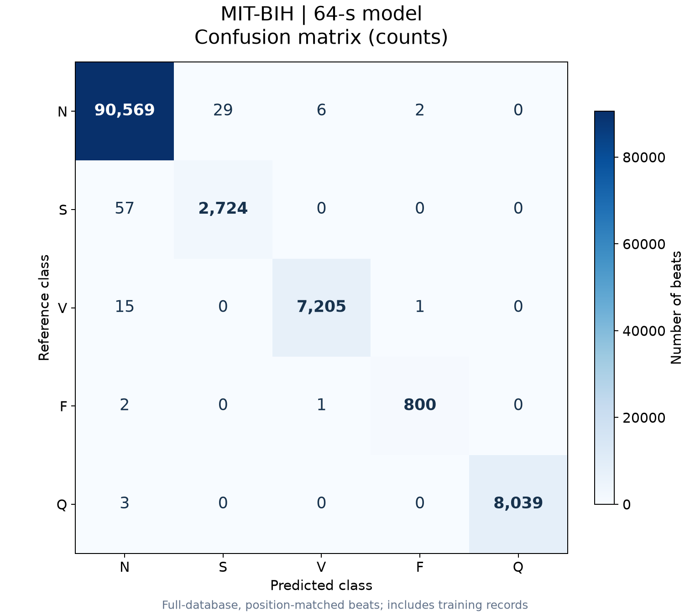

<div align="center">

# MIT-BIH Heartbeat Classification Model

## ≈99.9% Heartbeat Classification Accuracy

**Multi-scale CNN + Transformer**

**Heartbeat Classification Macro-F1: 99.57% | R-peak Detection F1: 99.95%**

<sub>64-s model · MIT-BIH full database, including training records · 99.89% accuracy and 99.57% five-class macro-F1 on position-matched beats</sub>

[English](README.md) | [简体中文](README.zh-CN.md)

**[License: Apache-2.0](LICENSE)**

[App Demo](#desktop-app-demo) · [Architecture](#model-architecture) · [Results](#results) · [Quick Start](#quick-start)

</div>

---

**Turn continuous ECG into beat locations, heartbeat classes, and interpretable label regions.**

The primary task is **heartbeat classification**, with **beat localization / R-peak detection** evaluated alongside it. Both outputs are derived from the same dense labeling model and its postprocessing.

This project combines multi-scale convolutional features with bidirectional temporal context to label ECG samples as background or one of five heartbeat classes: **N, S, V, F, and Q**. It includes training code, three pretrained models, full-record evaluation, and a desktop application for comparing predictions with reference annotations.

## Highlights

- **Morphology and context:** three convolutional branches with kernels 3, 5, and 7, followed by non-causal Transformer attention.
- **Three context lengths:** pretrained **16-s, 32-s, and 64-s** models for controlled exploration of input duration.
- **Dense predictions:** sample-level class scores are decoded into beat regions, locations, and categories.
- **Visual inspection:** view reference labels, raw predictions, and postprocessed predictions alongside the ECG.
- **Complete evaluation workflow:** per-record counts, detection metrics, class metrics, and confusion matrices.
- **Multiple databases:** MIT-BIH, European ST-T, and patient subsets from Icentia11k, with sampling-rate conversion.

## Desktop App Demo


**Actual application screenshot:** the 32-s model on MIT-BIH record 200. Top: reference labels. Middle: raw model predictions. Bottom: V5 postprocessed labels. The viewer displays 16 seconds at a time and supports scrolling and 10-second navigation steps. The current desktop interface is in Chinese.

## Model Architecture



[SVG](docs/images/model_architecture_en.svg) · [PDF](docs/images/model_architecture_en.pdf)

Three parallel CNN branches encode waveform features at different temporal scales. Their outputs are concatenated and projected to 192 channels. Three Transformer encoder layers use the entire window as context; five upsampling stages restore the original temporal resolution.

| Component | Configuration |
|---|---|
| Input | Single-lead ECG at 360 Hz; 16 / 32 / 64 seconds |
| CNN branches | Kernels 3 / 5 / 7; five stride-2 layers per branch |
| Channels | 8 → 16 → 32 → 64 → 128 per branch |
| Fusion | Concatenate to 384 channels; project to 192 |
| Transformer | 3 layers, 6 heads, feed-forward dimension 384 |
| Output | Six logits per sample: background + N / S / V / F / Q |

## Training, Validation, and Held-out Test Sets

The models use **separate training, validation, and test window sets**. Test windows are not directly used for gradient updates or checkpoint selection.

1. **Training:** update model parameters using training windows only.
2. **Validation:** select the best checkpoint using validation pointwise macro-F1 over N/S/V/F/Q.
3. **Held-out test:** after training, reload the selected checkpoint and evaluate the test windows.
4. **Full-database evaluation:** separately run the completed model over all MIT-BIH records. The headline 99.89% matched-beat accuracy comes from this additional evaluation, not the held-out test table below.

Original S/V/F/Q-centered windows are randomly split **70% / 10% / 20%** with seed 42. After adding supplemental rhythm-N windows, all three experiments have:

| Training windows | Validation windows | Test windows | Total |
|---:|---:|---:|---:|
| 13,224 | 1,892 | 3,778 | 18,894 |

### Validation and Held-out Test Performance

| Window | Selected epoch | Validation pointwise macro-F1 | Test pointwise macro-F1 |
|---|---:|---:|---:|
| 16 s | 50 | 98.83% | 98.72% |
| 32 s | 48 | 99.48% | 99.52% |
| 64 s | 49 | 99.78% | 99.76% |

These are **sample-level macro-F1 scores across N/S/V/F/Q**, excluding background; they are distinct from beat classification accuracy and detection F1. Splits are defined by windows rather than patients, so the same record and overlapping context can occur across sets.

[Class distributions and saved split artifacts](reports/published/internal_split_results.md)

## V5 Inference Rules

V5 turns dense labels into beat regions using fixed rules: **no background-gap filling**, removal of regions shorter than **100 ms**, contextual filtering of short regions below **180 ms**, ECG-guided splitting of regions longer than **500 ms**, and **N priority when its sample proportion exceeds 10%**. Other regions use the majority class. Ordinary regions use midpoint localization; split regions use their ECG candidate peaks. The App paints each final region with one class.

[Full thresholds, execution order, and edge cases](docs/postprocessing_v5.md)

## Results

### MIT-BIH

| Window | R-peak Precision | R-peak Recall | R-peak F1 | Matched-beat Classification Accuracy |
|---|---:|---:|---:|---:|
| 16 s | 99.90% | 99.94% | 99.92% | 99.57% |
| 32 s | **99.94%** | 99.95% | **99.95%** | 99.82% |
| 64 s | 99.93% | **99.96%** | **99.95%** | **99.89%** |

Classification accuracy is the confusion-matrix diagonal sum divided by the number of position-matched beats. Detection errors are reported separately.

### Row-normalized Confusion Matrix



Each row sums to approximately 100% after rounding. Diagonal entries show the recall of each class among position-matched beats, making minority-class performance easier to inspect.

<details>
<summary><b>Count matrix and all three models</b></summary>



| Window | Counts | Percentages | Percentage CSV |
|---|---|---|---|
| 16 s | [Image](docs/images/confusion_16s_counts_en.png) | [Image](docs/images/confusion_16s_percent_en.png) | [CSV](docs/images/confusion_16s_percent.csv) |
| 32 s | [Image](docs/images/confusion_32s_counts_en.png) | [Image](docs/images/confusion_32s_percent_en.png) | [CSV](docs/images/confusion_32s_percent.csv) |
| 64 s | [Image](docs/images/confusion_64s_counts_en.png) | [Image](docs/images/confusion_64s_percent_en.png) | [CSV](docs/images/confusion_64s_percent.csv) |

Each image also has a same-named SVG file.

</details>

**Per-class F1**

| Window | N | S | V | F | Q |
|---|---:|---:|---:|---:|---:|
| 16 s | 99.76% | 93.94% | 99.38% | 95.56% | 99.96% |
| 32 s | 99.90% | 97.55% | 99.77% | 98.17% | 99.98% |
| 64 s | **99.94%** | **98.45%** | **99.84%** | **99.63%** | **99.98%** |

### External Datasets and Training Separation

**European ST-T and Icentia11k are external datasets for all three released checkpoints.** Model training, validation-based checkpoint selection, and internal test-window evaluation use MIT-BIH only. No ST-T or Icentia11k samples were introduced into training or fine-tuning of these released weights. Historical ST-T fine-tuning code is retained as a legacy experiment and is not the source of the released checkpoints.

| Dataset | Role for the released models | Used to train / fine-tune weights? | Used for validation checkpoint selection? |
|---|---|---|---|
| MIT-BIH | Training, validation, internal test; additional full-database evaluation | Yes, training split only | Yes, validation split only |
| European ST-T | External cross-database evaluation | No | No |
| Icentia11k | External generalization evaluation (code only) | No | No |

External records have also been inspected to debug inference and postprocessing. Thus the weights are evaluated across databases without external-data training, but the complete pipeline is not an untouched external benchmark. 

### External Generalization Results: European ST-T

| Window | R-peak F1 | S-class F1 | V-class F1 |
|---|---:|---:|---:|
| 16 s | 99.70% | 4.13% | 75.77% |
| 32 s | 99.76% | 7.51% | **85.84%** |
| 64 s | 99.76% | **11.97%** | 65.44% |

These results highlight the remaining challenge of cross-database heartbeat classification. For Icentia11k, this release provides evaluation code only; no results are published.

<details>
<summary><b>Evaluation protocol and reproducibility</b></summary>

The three models were trained on MIT-BIH only. Training, validation, and test windows have separate roles as described above. Windows are randomly split 7:1:2; records and overlapping contexts can cross splits. The later full-database evaluation covers all records, including those used to form training windows; it is separate from the held-out test-window evaluation.

The tables are historical report snapshots. Match tolerances are recorded in the individual reports; the example commands below use ±150 ms. Classification metrics use only position-matched beats.

For Icentia11k, reference Q beats participate in location scoring but not class scoring. Predicting Q for a reference N/S/V beat remains a classification error.

[Report index (Chinese)](reports/发布结果汇总.md) · [Saved report artifacts](reports/published/)

</details>

## Quick Start

### 1. Install

Use Python 3.12 with Tkinter support. From the repository root:

```bash
python -m pip install -r requirements.txt
python -m pip install torch --index-url https://download.pytorch.org/whl/cpu
```

To use the recorded local CUDA 13.0 environment instead:

```bash
python -m pip install -r requirements-local-cuda.txt
```

Dependencies are a snapshot of the development environment; a clean-environment installation has not yet been validated.

### 2. Prepare a WFDB Record

Download a record from [MIT-BIH](https://physionet.org/content/mitdb/1.0.0/). Keep its matching `.hea`, `.dat`, and `.atr` files together. The original databases are not included in this repository.

### 3. Launch the App

```bash
python -m mitbih_aami.desktop_app --checkpoint ./checkpoints/ecg_cnn_transformer_32s.pt --postprocess v5
```

Select the `.hea` file and wait for full-record inference. Input signals are resampled to the model's 360 Hz when needed.

## Pretrained Models

| Window | Checkpoint | Input Samples |
|---|---|---:|
| 16 s | [Download](checkpoints/ecg_cnn_transformer_16s.pt) | 5,760 |
| 32 s | [Download](checkpoints/ecg_cnn_transformer_32s.pt) | 11,520 |
| 64 s | [Download](checkpoints/ecg_cnn_transformer_64s.pt) | 23,040 |

Each checkpoint is approximately 5–6 MB and is included with the repository. [File sizes and SHA256](docs/model_manifest.json).

## Train and Evaluate

Train a 32-second model:

```bash
python -m mitbih_aami.train_long_context --database-dir ./mit-bih-arrhythmia-database-1.0.0 --output-dir ./runs/my_32s_model --window-seconds 32 --epochs 50 --batch-size 8
```

Evaluate full records:

```bash
python -m mitbih_aami.evaluate_records --database-dir ./mit-bih-arrhythmia-database-1.0.0 --checkpoint ./checkpoints/ecg_cnn_transformer_32s.pt --output-dir ./runs/my_mitbih_evaluation --tolerance-ms 150
```

Evaluate Icentia patients 00000–00049 with all three models:

```bash
python -m mitbih_aami.evaluate_icentia --database-dir ./icentia11k-continuous-ecg-1.0 --patient-start 0 --patient-end 49 --tolerance-ms 150 --output-dir ./runs/icentia_00000_00049_v5_Qposition
```

## Repository Guide

| File / Directory | Purpose |
|---|---|
| `mitbih_aami/cnn_transformer.py` | Model architecture |
| `mitbih_aami/ecg_data.py` | Loading, preprocessing, and targets |
| `mitbih_aami/train_16s.py` | 16-second training |
| `mitbih_aami/train_long_context.py` | 32/64-second training |
| `mitbih_aami/evaluate_records.py` | MIT-BIH and ST-T evaluation |
| `mitbih_aami/evaluate_icentia.py` | Icentia patient-subset evaluation |
| `mitbih_aami/desktop_app.py` | Desktop viewer |
| `checkpoints/` | Three pretrained models |
| `reports/published/` | Historical metrics and training configurations |
| `docs/images/` | App screenshot and publication-style figures |

Additional usage, download instructions, and design notes are currently available in the [Chinese documentation](README.zh-CN.md#文档导航).

## Data and Licensing

Data sources: [MIT-BIH](https://physionet.org/content/mitdb/1.0.0/), [European ST-T](https://physionet.org/content/edb/1.0.0/), and [Icentia11k](https://physionet.org/content/icentia11k-continuous-ecg/1.0/). Follow each dataset's license and citation requirements.

Original project code, pretrained model weights, documentation, and figures are licensed under the [Apache License 2.0](LICENSE). Commercial use is permitted under its terms. Third-party datasets and dependencies retain their own licenses. See [NOTICE](NOTICE).
