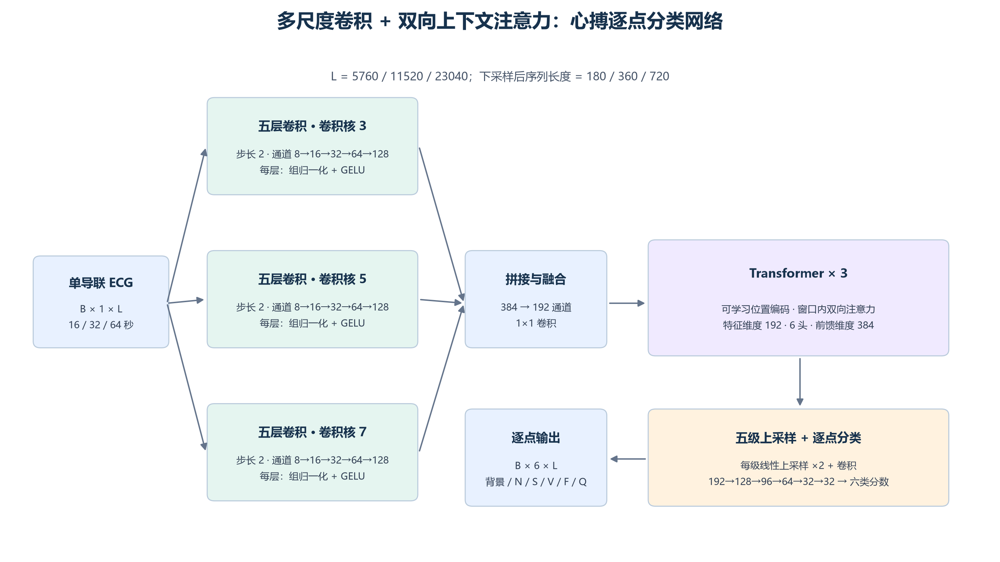
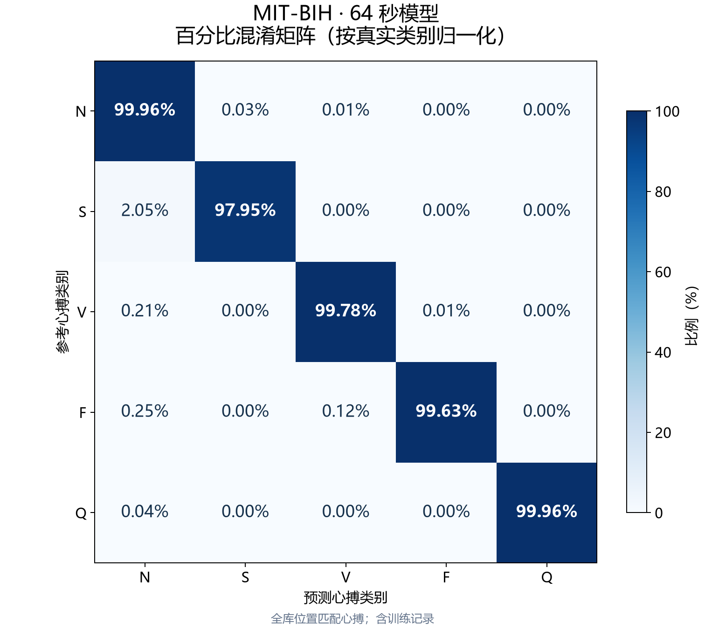
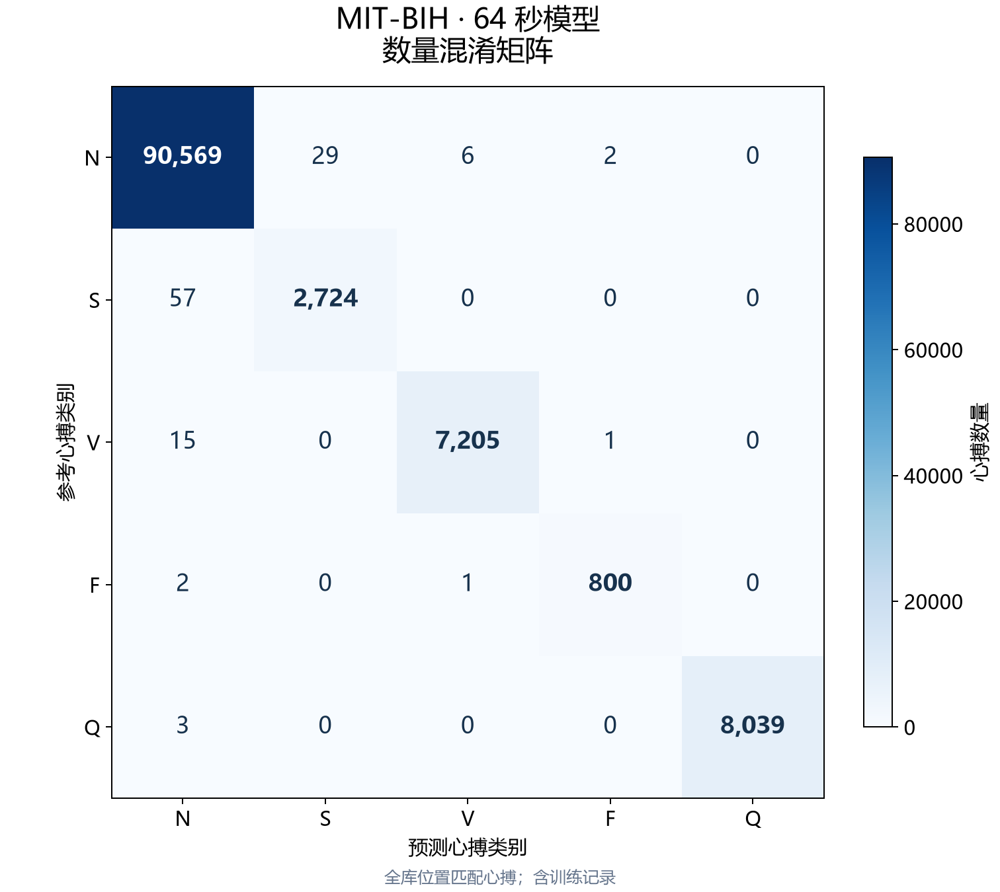
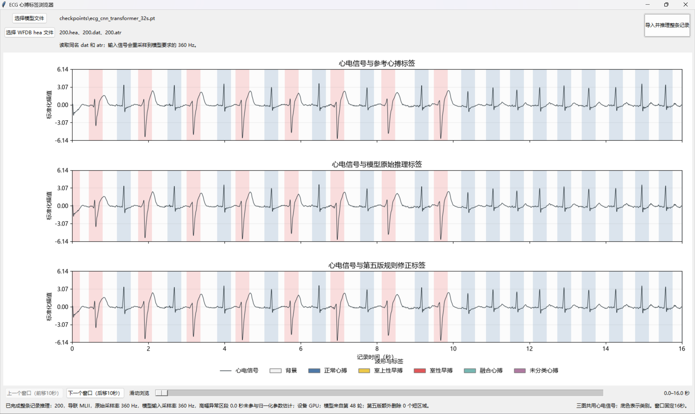

[English](README.md) | 简体中文

<div align="center">

# 基于MITBIH的心搏分类模型

## 心搏分类准确率约 99.9%

**多尺度 CNN × Transformer**

**心搏分类宏 F1 99.57%｜R 峰检测 F1 99.95%**

<sub>64 秒模型 · MIT-BIH 全库（含训练记录）· 位置匹配后分类准确率 99.89%，五类别宏 F1 99.57%</sub>

**R 峰定位 · 五类心搏分类 · 长时上下文 · 可视化桌面 App**

[快速体验](#快速体验) · [模型结构](#模型如何工作) · [实验结果](#实验结果) · [使用文档](#文档导航)

</div>

---

**给模型一段连续 ECG，得到每个心搏的位置、类别，以及可以直接查看的标签区域。**

本项目以**心搏类型分类为主要任务**，同时评价**心搏定位／R峰检测**；两项结果由同一个逐点标签模型与后处理获得。

本项目将波形识别与节律上下文结合起来：三路卷积学习不同时间尺度的局部形态，Transformer 关联窗口内前后的心搏，逐点预测再转为心搏位置与类别。项目提供从训练、整条记录推理、评估报告到桌面查看器的完整流程，并附带 **16 / 32 / 64 秒三个预训练模型**。


## 项目特点

- **定位心搏**：从连续 ECG 中识别心搏区域，输出心搏位置。
- **识别类型**：逐点输出背景及 N / S / V / F / Q，再汇总为逐搏类别。
- **比较上下文长度**：使用同一类网络对比 16、32、64 秒窗口。
- **直观看到错误**：在桌面 App 中对照参考标签、原始预测与后处理结果。
- **评估完整记录**：输出检测计数、分类混淆矩阵、精确率、敏感度和 F1。
- **探索跨库表现**：支持 MIT-BIH、European ST-T，以及 Icentia11k 患者子集。

## 模型如何工作？

判断一个心搏，既要看它的形态，也要看它和前后心搏的关系。本项目用多尺度卷积与非因果自注意力分别建模这两部分信息；它们是否学到了预期特征，仍需可视化或消融实验验证。



[下载矢量架构图](docs/images/model_architecture.svg)

| 组件 | 设计 |
|---|---|
| 输入 | 单导联 ECG，360 Hz；16 / 32 / 64 秒 |
| 波形编码 | 三路卷积核 3 / 5 / 7；每路五层、步长 2 |
| 通道 | 每路 8 → 16 → 32 → 64 → 128；拼接 384，融合为 192 |
| 上下文建模 | 三层 Transformer，6 个注意力头，窗口内双向上下文 |
| 输出 | 与输入等长的六类逐点分数：背景 + 五类心搏 |
| 后处理 | 区域合并、短区域处理、长区域拆分及区域类别判定 |

详细参数、标签生成和数据划分见[模型与实验设计](docs/模型与实验设计.md)。

## 训练集、验证集与测试集

模型训练使用单独划分的训练、验证和测试窗口。**测试窗口不直接用于梯度更新，也不用于选择最佳模型。**

1. 训练集用于更新网络参数。
2. 验证集根据 N/S/V/F/Q 逐点宏 F1 选择最佳模型。
3. 训练结束后，重新加载最佳模型，在预留测试窗口上单独测试。
4. 模型训练完成后，另外进行 MIT-BIH 整个数据库的推理评估。首页约99.9%的逐搏分类准确率来自这项全库评估，与下表测试集指标分开展示。

原始 S/V/F/Q 中心窗口按7:1:2、随机种子42划分，再补充节律N窗口。三个实验最终均为：

| 训练窗口 | 验证窗口 | 测试窗口 | 合计 |
|---:|---:|---:|---:|
| 13,224 | 1,892 | 3,778 | 18,894 |

| 输入窗口 | 最佳轮次 | 验证集逐点宏F1 | 测试集逐点宏F1 |
|---|---:|---:|---:|
| 16 s | 50 | 98.83% | 98.72% |
| 32 s | 48 | 99.48% | 99.52% |
| 64 s | 49 | 99.78% | 99.76% |

这里的宏F1只平均N/S/V/F/Q，不含背景，是逐点分割指标，不是逐搏分类准确率或R峰检测F1。划分单位是窗口；同记录及重叠上下文可能跨集合，因此并非患者间独立划分。

[各集合中心类别数量及原始划分记录](reports/published/internal_split_results.md)

## V5 推理规则

不填补背景缝隙；删除不足100ms的区域；根据邻近心搏和RR条件删除部分不足180ms的短段；超过500ms时尝试按ECG候选峰拆分；N占比大于10%则判N，否则取主类别。普通区域按中点定位，拆分区域按候选峰定位，App将最终区域统一着色。

[完整参数、执行顺序与边界情况](docs/V5后处理规则.md)

## 实验结果

### 64 秒模型：分类结果一图看懂



每一行按该参考类别的总数归一化，表示该类心搏分别被预测为各类别的比例。对角线越高，说明该类别被正确识别的比例越高；这与总体准确率是不同指标。

<details>
<summary><b>查看数量混淆矩阵与其他窗口结果</b></summary>



| 窗口 | 数量图 | 百分比图 | 百分比表格 |
|---|---|---|---|
| 16 秒 | [查看](docs/images/confusion_16s_counts.png) | [查看](docs/images/confusion_16s_percent.png) | [CSV](docs/images/confusion_16s_percent.csv) |
| 32 秒 | [查看](docs/images/confusion_32s_counts.png) | [查看](docs/images/confusion_32s_percent.png) | [CSV](docs/images/confusion_32s_percent.csv) |
| 64 秒 | [查看](docs/images/confusion_64s_counts.png) | [查看](docs/images/confusion_64s_percent.png) | [CSV](docs/images/confusion_64s_percent.csv) |

以上图片同时提供同名 SVG 文件，便于论文排版和缩放。百分比保留两位小数，逐行舍入后合计可能略有偏差。

</details>

### MIT-BIH：三个窗口长度的对比

以下为已有报告中的全库结果。位置匹配后计算分类准确率：**混淆矩阵对角线之和 ÷ 矩阵总数**；漏检、多检由检测指标单独体现。

| 输入窗口 | R 峰精确率 | R 峰敏感度 | R 峰 F1 | 匹配后分类准确率 |
|---|---:|---:|---:|---:|
| 16 秒 | 99.90% | 99.94% | 99.92% | 99.57% |
| 32 秒 | **99.94%** | 99.95% | **99.95%** | 99.82% |
| 64 秒 | 99.93% | **99.96%** | **99.95%** | **99.89%** |

**各类心搏 F1**

| 输入窗口 | N | S | V | F | Q |
|---|---:|---:|---:|---:|---:|
| 16 秒 | 99.76% | 93.94% | 99.38% | 95.56% | 99.96% |
| 32 秒 | 99.90% | 97.55% | 99.77% | 98.17% | 99.98% |
| 64 秒 | **99.94%** | **98.45%** | **99.84%** | **99.63%** | **99.98%** |

来源：[历史结果汇总](reports/发布结果汇总.md) · [64 秒检测与分类指标](reports/published/mitbih_64s_eval_v5_matrix/分类指标.csv) · [64 秒混淆矩阵](reports/published/mitbih_64s_eval_v5_matrix/五分类混淆矩阵.csv)

### 外部数据集与训练隔离

**European ST-T 和 Icentia11k 均是当前三个发布权重的外部数据集。** 训练、验证选模和内部测试均在 MIT-BIH 上进行；ST-T、Icentia11k 没有参与这三个权重的训练或微调，也没有用于验证集最佳模型选择。保留的 ST-T 微调脚本属于历史实验，不是当前发布权重的来源。

| 数据库 | 用途 | 是否参与权重训练或微调 | 是否参与验证选模 |
|---|---|---|---|
| MIT-BIH | 训练、验证、内部测试及额外全库评估 | 仅训练集参与 | 仅验证集参与 |
| European ST-T | 外部跨库评估 | 否 | 否 |
| Icentia11k | 外部泛化评估（仅代码） | 否 | 否 |

外部记录曾用于排查推理和后处理问题。因此可以明确声明“发布权重未使用外部数据训练”，但不能将完整推理流程称为“完全未根据外部数据调试”。

### 外部数据库：泛化还有哪些挑战？

当前三个权重仅用 MIT-BIH 训练。European ST-T 的已有全库结果如下，说明较高的 R 峰检测分数并不意味着所有心搏类别都能同样泛化。

| 输入窗口 | R 峰 F1 | S 类 F1 | V 类 F1 |
|---|---:|---:|---:|
| 16 秒 | 99.70% | 4.13% | 75.77% |
| 32 秒 | 99.76% | 7.51% | **85.84%** |
| 64 秒 | 99.76% | **11.97%** | 65.44% |

Icentia11k 仅提供外部泛化评估代码，不发布评估结果。

<details>
<summary><b>如何理解这些结果与实验边界？</b></summary>

- 内部数据按窗口随机 7:1:2 划分，同记录和重叠片段可能跨集合；这不是患者间独立划分。
- MIT-BIH 全库包含训练记录，其成绩用于描述库内表现，不代表未见患者泛化水平。
- 分类表只统计位置匹配成功的心搏，必须结合 R 峰检测指标阅读。
- 本页数字来自保存的历史报告；具体容差以原报告为准。新命令使用 ±150 ms，不能直接当作历史报告的复现配置。
- Icentia 的参考 Q 参与位置评分，不参与类型评分；参考 N/S/V 被预测为 Q 仍是错分。

</details>

## 桌面 App 演示



32 秒模型 · MIT-BIH 记录 200。三个子图分别为参考标签、原始预测和 V5 后处理结果。

## 快速体验

### 1. 安装环境

在项目根目录运行。建议使用 Python 3.12，并确保 Python 安装包含 Tkinter。

```powershell
python -m pip install -r requirements.txt
python -m pip install torch --index-url https://download.pytorch.org/whl/cpu
```

上面使用 CPU 版 PyTorch。需要复现本地 CUDA 13.0 依赖时，改用：

```powershell
python -m pip install -r requirements-local-cuda.txt
```

依赖文件记录现有本机版本，尚未在全新环境完成安装验证。

### 2. 准备一条 ECG

从 [MIT-BIH 官方页面](https://physionet.org/content/mitdb/1.0.0/) 下载记录，把同名 `.hea`、`.dat`、`.atr` 放在同一目录。完整下载命令及其他数据库见[数据与常用命令](docs/常用命令与数据库下载.md)。

### 3. 启动桌面 App

三个权重已随项目放在 `checkpoints/`，每个约 5–6 MB。以 32 秒模型为例：

```powershell
python -m mitbih_aami.desktop_app --checkpoint ./checkpoints/ecg_cnn_transformer_32s.pt --postprocess v5
```

在界面中选择 `.hea` 文件，等待完整记录推理完成，即可对照查看：

| 子图 | 内容 |
|---|---|
| 上图 | ECG 信号 + 参考心搏标签 |
| 中图 | ECG 信号 + 模型原始逐点预测 |
| 下图 | ECG 信号 + 后处理后的心搏标签 |

每次显示 16 秒，支持滑动浏览和前后移动 10 秒；显示长度与模型输入窗口长度相互独立。250 Hz 等输入会转换为模型使用的 360 Hz。

## 预训练模型

| 输入窗口 | 权重 | 输入点数 |
|---|---|---:|
| 16 秒 | [ecg_cnn_transformer_16s.pt](checkpoints/ecg_cnn_transformer_16s.pt) | 5760 |
| 32 秒 | [ecg_cnn_transformer_32s.pt](checkpoints/ecg_cnn_transformer_32s.pt) | 11520 |
| 64 秒 | [ecg_cnn_transformer_64s.pt](checkpoints/ecg_cnn_transformer_64s.pt) | 23040 |

[权重 SHA256](docs/model_manifest.json) · [训练配置与历史报告](reports/published/README.md)

## 自己训练与评估

训练一个 32 秒模型：

```powershell
python -m mitbih_aami.train_long_context --database-dir ./mit-bih-arrhythmia-database-1.0.0 --output-dir ./runs/my_32s_model --window-seconds 32 --epochs 50 --batch-size 8
```

使用随仓库提供的模型评估完整数据库：

```powershell
python -m mitbih_aami.evaluate_records --database-dir ./mit-bih-arrhythmia-database-1.0.0 --checkpoint ./checkpoints/ecg_cnn_transformer_32s.pt --output-dir ./runs/my_mitbih_evaluation --tolerance-ms 150
```

报告包含逐记录与汇总计数、分类混淆矩阵及各类指标。16/64 秒训练、ST-T 和 Icentia 评估命令见[完整使用说明](docs/常用命令与数据库下载.md)。

## 文档导航

| 我想了解…… | 从这里开始 |
|---|---|
| 网络结构、类别映射、标签和划分 | [模型与实验设计](docs/模型与实验设计.md) |
| 下载数据库、打开 App、运行评估 | [常用命令与数据库下载](docs/常用命令与数据库下载.md) |
| 每条记录的成绩和混淆矩阵 | [历史结果汇总](reports/发布结果汇总.md) |
| Icentia 子集及评分约定 | [Icentia 评估说明](docs/external_evaluation.md) |

<details>
<summary><b>项目目录</b></summary>

```text
checkpoints/                  三个预训练模型
mitbih_aami/
  cnn_transformer.py          网络结构
  ecg_data.py                 信号预处理与标签
  train_16s.py                16 秒训练
  train_long_context.py       32 / 64 秒训练
  evaluate_records.py         MIT-BIH / ST-T 评估
  evaluate_icentia.py         Icentia 子集评估
  beat_postprocess.py         心搏区域后处理
  desktop_app.py              桌面查看器
  legacy_*.py                 历史实现及兼容依赖
docs/                         使用与实验说明
reports/published/            历史结果与训练配置快照
tools/                        汇总和错误分析工具
```

数据库、缓存和本地 `runs/` 不随仓库提交。

</details>

## 数据来源与授权

感谢 [MIT-BIH](https://physionet.org/content/mitdb/1.0.0/)、[European ST-T](https://physionet.org/content/edb/1.0.0/) 和 [Icentia11k](https://physionet.org/content/icentia11k-continuous-ecg/1.0/) 提供公开研究数据。使用数据时请遵循各来源的许可与引用要求。

原创代码、预训练权重、文档和图示采用 [Apache License 2.0](LICENSE)，遵守条款即可商用。第三方数据库和依赖遵守各自许可。参见 [NOTICE](NOTICE)。
